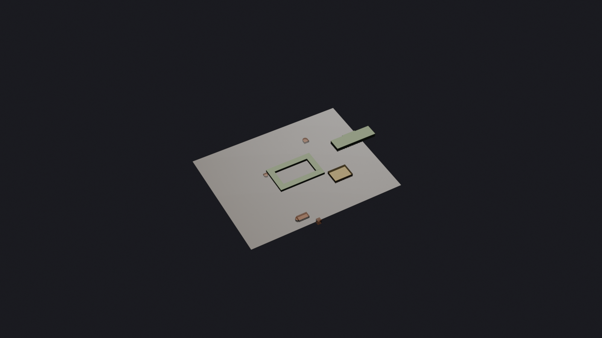

# Medijana (Naissus) — Vila Konstantina kod Niša

**Digitalni arheološki blizanac i forenzička prostorno-materijalna baza kasnoantičkog carskog kompleksa Medijana**

Repozitorijum konsoliduje ono čime projekat trenutno raspolaže, kao osnova za razgovor o naučno-tehničkoj saradnji sa Arheološkim institutom u Beogradu, Narodnim muzejom u Nišu i Zavodom za zaštitu spomenika kulture Niš.

---

## Šta je cilj

Prevođenje 90 godina objavljenih arheoloških i arhitektonskih istraživanja Medijane (Vasić 1936 → kampanje 2024–2026) u **živ, naučno proverljiv, četvorodimenzionalni digitalni blizanac** — otvoren 3D prikaz u pretraživaču (WebGPU/HBIM), gde svaki prikazani element nosi svoj arheološki dokaz i nivo pouzdanosti.

Metodološki okvir: **Londonska povelja (2009)** i **Principi iz Sevilje (2011)** — transparentni paradata slojevi, trostepena skala verodostojnosti (A činjenica · B analogija · C hipoteza), CIDOC CRM / CRMarchaeo semantika, FAIR principi.

## Čime raspolažemo (oktobar 2026)

| Dokument | Sadržaj |
|---|---|
| [01 · Naučna forenzička struktura](docs/01_NAUCNA_FORENZICKA_STRUKTURA.md) | Medijana kroz 4 stuba dokaza (arhitektura, tlo, numizmatika, artefakti); 4 graditeljske faze; objekti: vila sa peristilom, stibadijum, oktogon, terme, horreum, crkve, nekropola. |
| [02 · Digitalni blizanac i standardi](docs/02_DIGITALNI_BLIZANAC_I_STANDARDI.md) | London Charter / Seville Principles; paradata matrica pouzdanosti A/B/C; WebGPU/OpenUSD tehnološki stek; vremenska osa. |
| [03 · Institucionalni okvir i akcioni plan](docs/03_INSTITUCIONALNI_OKVIR_I_AKCIONI_PLAN.md) | Mapiranje institucija i nadležnosti; pozicija tehnološkog partnera; finansijski kanali (Ministarstvo kulture, Fond za nauku, Creative Europe, Horizon Europe); faze P1–P4. |
| [04 · Bibliografija i izvori](docs/04_BIBLIOGRAFIJA_I_IZVORI.md) | Anotirana bibliografija 1936–2026: Vasić, Petrović, Milošević, Jeremić, Drča, Gavrilović Vitas, izveštaji tekućih kampanja. |
| [05 · Nivoi analize](docs/05_NIVOI_ANALIZE.md) | Lestvica N0–N6 (pejzaž → molekul): koja nauka radi na kom nivou, prelazi nivoa kao mesta greške, slojevi u blizancu. |
| [06 · Hipoteze i pitanja](docs/06_HIPOTEZE_I_PITANJA.md) | Ground truth hijerarhija T1–T4; matrica tvrdnji × izvora; registri kontradikcija KR-01–KR-05; hipoteze M-H01–M-H10; istraživačka pitanja M-Q01–M-Q14. |

**Koncept repozitorijuma:** [00 · GitHub i Pages](docs/00_KONCEPT_GITHUB_I_PAGES.md) — repo kao laboratorijska sveska sa pečatom vremena; dva lica (repo za nauku, Pages za javnost) nad jednim izvorom istine; put rasta P1–P4.

**Strojni registri** (renderuju se uživo na [`registri.html`](registri.html) i u 3D prikazu):
- [`data/RECNIK.jsonl`](data/RECNIK.jsonl) — 20 definisanih stručnih pojmova sa izvorima
- [`data/NIVOI.jsonl`](data/NIVOI.jsonl) — registar 7 nivoa analize (N0–N6): discipline, metode, materijal Medijane, HBIM sloj
- [`data/HIPOTEZE.jsonl`](data/HIPOTEZE.jsonl) — 10 hipoteza M-H01–M-H10: tvrdnja, test, potvrda, opovrgnuće, status
- [`data/KONTRADIKCIJE.jsonl`](data/KONTRADIKCIJE.jsonl) — 5 registara kontradikcija KR-01–KR-05 (KR-01 razrešen kroz arhitektonski nalaz cella vinaria)
- [`data/PITANJA.jsonl`](data/PITANJA.jsonl) — 14 istraživačkih pitanja M-Q01–M-Q14
- [`data/GEOMETRIJA.jsonl`](data/GEOMETRIJA.jsonl) — 14 prostornih elemenata G-*: oblik, mere, visine (sačuvano/rekonstruisano), poreklo svake mere, izvori i vezane hipoteze (artikulisan prostorni pilot horreuma sa trobrodnom kolonadom, bazenima i tremom; sporni oktogon isključen na osnovu MED-11)
- [`data/IZVORI.jsonl`](data/IZVORI.jsonl) — 13 anotiranih izvora MED-01–MED-13: uključujući primarni antički narativni izvor (Amijan Marcelin, 364. n.e., MED-13), istraživački talasi 0–4
- [`data/VEZE_IZVORA.jsonl`](data/VEZE_IZVORA.jsonl) — 6 eksplicitnih veza A-MEDIJANA-* ↔ MED-* sa statusima (`potvrdjena_veza`, `blokirano`, `kandidat`)
- [`data/LOKACIJE.jsonl`](data/LOKACIJE.jsonl) — 13 povezanih lokacija L-*: Via Diagonalis, tetrarhijski komparativi, nekropole — sa izgovorenom preciznošću svake koordinate
- [`data/HRONOLOGIJA.jsonl`](data/HRONOLOGIJA.jsonl) — 13 događaja HR-*: od Konstantinovog rođenja do tekućih iskopavanja (potvrđen carski boravak 364. n.e. po izvoru MED-13)

**Sajt — jedan izvor istine, osam stranica** (sve čitaju `data/*.jsonl` uživo):

| Stranica | Šta pokazuje |
|---|---|
| [`index.html`](index.html) | Naslovna sa glavnim 2D/3D prikazom (ugrađena maketa i mapa) |
| [`index-en.html`](index-en.html) | Engleski pregled i portal međunarodne saradnje (London Charter, Seville Principles, Horizon Europe / Creative Europe) |
| [`blizanac.html`](blizanac.html) | 3D radna maketa — Three.js, preklop sačuvano ↔ rekonstrukcija, klik = dokaz, GLB preuzimanje |
| [`mapa.html`](mapa.html) | 2D mapa: region (carska geografija oko Via Diagonalis) i lokalitet (šematski overlay kompleksa preko satelitskog snimka, vizuelno poravnat sa zaštitnom konstrukcijom) |
| [`istrazivanje.html`](istrazivanje.html) | Istraživački radni sto: hipoteze, otvorena pitanja i kontradikcije sa filterima i vezama ka 3D |
| [`pokrivenost.html`](pokrivenost.html) | Kartoni pokrivenosti elemenata: poreklo mera, status bibliografskih veza, sledeći koraci |
| [`registri.html`](registri.html) | Svi strojni registri sa interaktivnim tabovima i statusnim značkama |
| [`izvori.html`](izvori.html) | Anotirana bibliografija u četiri talasa + hronologija 272–2026 |

**Digitalni blizanac — 3D radna maketa** ([`blizanac.html`](blizanac.html)): Three.js scena generisana uživo iz `GEOMETRIJA.jsonl`. Boja = poreklo mere (objavljena dimenzija / izvedeno iz objavljene površine / šematski); preklop „sačuvano stanje ↔ rekonstrukcija"; klik na objekat otvara dokaz, granice i vezane hipoteze. Isti registar gradi i Blender model: [`tools/blizanac_blender.py`](tools/blizanac_blender.py) → [`modeli/medijana.glb`](modeli/medijana.glb) + [render](assets/blizanac-render.png). Raspored objekata je šematski dok se u P2 ne preuzme georeferencirani plan.



Projekat je citabilan preko [`CITATION.cff`](CITATION.cff); nova hipoteza i novi izvor ulaze kroz [issue šablone](.github/ISSUE_TEMPLATE/) sa obaveznim testom, potvrdom i opovrgnućem.

## Šta ovaj repozitorijum (još) nije

Granice su deo metoda i izgovaraju se tačno:

- **Nema novih terenskih podataka.** Sve je sinteza objavljene literature i javnih izveštaja; nijedan nalaz nije naš.
- **Nema formalnog sporazuma sa institucijama** — ovaj materijal je priprema za taj razgovor, ne njegov rezultat.
- **HBIM još ne postoji; 3D maketa nije rekonstrukcija.** Radna maketa (`blizanac.html`) je prostorni registar znanja sa šematskim rasporedom — bez georeferenciranja, bez arhitektonskog detalja. HBIM pilot (stibadijum sa mozaikom Meduze) ostaje faza P2.
- **Mapa nije geodetski snimak.** Overlay lokaliteta je isti šematski raspored položen preko satelitskog snimka (sidro vizuelno poravnato sa zaštitnom konstrukcijom); koordinate šire mape su očitane sa javnih karata, a za Šarkamen i Caričin grad čekaju referencu.
- **Katalog literature je nepotpun** — najveća praznina su izvori na srpskom, nemačkom i francuskom (pitanje M-Q13).
- Sve hipoteze M-H01–M-H10 nose status **NEPROVERENO**.

## Ponuda saradnje — tehnološki partner, ne konkurent

Projekat ne traži dozvole za iskopavanje i ne pretenduje na tumačenje nalaza. Donosi inženjerski sloj:

- alat za upravljanje terenskom dokumentacijom i praćenje konzervatorskog stanja u 3D prostoru;
- parametarski HBIM model vezan za bazu dokaza, sa paradata slojem po London Charter standardu;
- otvoren WebGPU prikaz koji radi u pregledaču bez instalacije softvera;
- CIDOC CRM / CRMarchaeo semantika i FAIR objava sa trajnim identifikatorom;
- tehnološki deo prijava za domaće i evropske fondove.

Nalazi, terenska dokumentacija i naučna interpretacija ostaju kod nadležnih ustanova i istraživača.

## Faze

1. **P1 — Naučno-forenzička konsolidacija** *(u toku, započeta 21.10.2026)*: literatura, rečnik, konceptualni model, nacrt sporazuma o saradnji.
2. **P2 — Pilot HBIM**: stibadijum sa mozaikom Meduze + paradata prototip.
3. **P3 — Integralni WebGPU blizanac**: ceo kompleks, 5 vremenskih faza.
4. **P4 — GIS kičma terena i edukativni moduli.**

---

## Licenca i citiranje

- **Kod** (`tools/`, `assets/*.js`, stranice suite-a): [MIT](LICENSE).
- **Istraživački sadržaj** (`docs/`, `data/*.jsonl`, `modeli/`, renderi): [CC BY 4.0](LICENSE-CONTENT).
- Autorska prava izvornih istraživača i vlasništvo ustanova nad nalazima ovim licencama **nisu** zahvaćeni — granice su izgovorene u [LICENSE-CONTENT](LICENSE-CONTENT).
- Citiranje: [`CITATION.cff`](CITATION.cff); Zenodo metapodaci: [`.zenodo.json`](.zenodo.json).

## Provera pre objave

```
node tools/proveri-registre.cjs   # registri: shema, identifikatori, veze, GLB
node tools/proveri-suite.cjs      # stranice: skelet, meta, navigacija, lokalne veze, privatnost
```

Oba prolaza su uslov za objavu — Pages workflow (`.github/workflows/pages.yml`) ne isporučuje sajt ako provera padne. Redosled navigacije održava `node tools/uskladi-navigaciju.cjs`, a meta blok i `sitemap.xml` `node tools/pripremi-launch.cjs`. Vizuelna provera mobilnog: `tools/provera/`.

Kontrolna lista objave: [`docs/08_LAUNCH.md`](docs/08_LAUNCH.md).

---

**Kontakt:** Semir Poturak · scumutator@gmail.com


## Istraživački sto · 22.10.2026.

`istrazivanje.html` povezuje hipoteze, kontradikcije i otvorena pitanja. Pretraga i filter N0–N6 čuvaju se u URL-u; izbor se izvozi u JSON ili štampa. Veze na 3D otvaraju odgovarajući objekat i njegov opis. Stranica sadrži predlog minimalnog paketa za razgovor sa Institutom i preuzimanje GLB makete; saradnja nije predstavljena kao ugovorena.

Oznake A-MEDIJANA i MED nisu automatski izjednačene. Raniji opisi pročitanosti nisu nova potvrda pristupa originalu. A-MEDIJANA-03 ima prijavljenu neusaglašenost iz ranijeg istraživanja; izvlačenje mera oktogona čeka proveru originalne publikacije.


## Pokrivenost modela · 22.10.2026.

[Pokrivenost](pokrivenost.html) daje karton svakog geometrijskog elementa: poreklo mera, položaj, visine, kandidat bibliografske veze i plan pribavljanja dokaza. Pretraga, filter, štampa i JSON izvoz rade nad registrima. `data/VEZE_IZVORA.jsonl` beleži pet kandidata povezivanja A-MEDIJANA → MED na osnovu lokalnih metapodataka; nije potvrda originala. Oktogon je blokiran za nove mere.

Provera podataka: `node tools/proveri-registre.cjs`. Strukturna ispravnost i razrešivi identifikatori nisu arheološka validacija.


## Provera identiteta oktogona · 22.10.2026.

MED-05 ostaje nepotvrđen bibliografski zapis, očuvan radi istorije. Ranija tvrdnja o punom čitanju nije dokaz pristupa originalu.

Novi [MED-11](https://doi.org/10.2298/STA1969247G) dokumentuje zgradu na Gradskom polju. Pročitane su strane 247–250; sl. 1–2 identifikovane su po legendama, bez vizuelnog pregleda crteža. Ne zaključujemo da u Medijani ne može postojati drugi oktogon. Zaključujemo da ovaj rad ne potvrđuje naš G-OKTOGON.

G-OKTOGON ostaje u registru sa starim merama i položajem, ali `prikaz:false` isključuje ga iz 2D/3D scene i novih Blender izvoza. Sledeće: proveriti izvorne planove Medijane i dokumentovati horreum tačnom stranom pre prostornog pilota.


## Unutrašnji plan horreuma i bibliografski identitet MED-04 · 22.10.2026.

Razjašnjen je bibliografski identitet za `MED-04`: razdvojeni su izložbena studija Petra Petrovića iz 1993. (*Naissus – zadužbina cara Konstantina*, Galerija SANU knj. 73) i kapitalna monografija sa arhitektonskim detaljima **Petar Petrović (1994), *Medijana – rezidencija rimskih careva*** (SANU / AI Beograd / NM Niš).

Monografija iz 1994. donosi precizne podatke za prvi prostorni pilot (horreum):
- **Unutrašnja artikulacija:** trobrodni prostor podeljen sa **dva podužna reda nosivih stubaca** duž građevine od 91×27 m.
- **Južni pokriveni trem sa rampom:** ulazni portik na stubovima sa pristupnom rampom za lakši prilaz i istovar zaprega (prenos žita i annone).
- **Cella vinaria i bazeni:** zapadni deo objekta u kasnijoj fazi pregrađen u vinski podrum sa zidanim bazenima dubine 1,40 m za ceđenje i skladištenje vina i ulja (direktna podrška za `M-H09` i razrešenje `KR-01`).
- **Ukopane dolije (*dolia defossa*):** smeštene duž brodova između stubaca, do pola ukopane radi stabilnosti i toplotne postojanosti.

U prostorni registar (`GEOMETRIJA.jsonl`) uneti su novi elementi `G-HORREUM-BASENI` i `G-HORREUM-TREM` (`objavljena_dimenzija`), a regenerisani Blender GLB model (123 čvora, 12 aktivnih elemenata) i render vizuelno potvrđuju potpunu pokrivenost bez odsecanja (piksel-raspon: 32.0–66.6% širine, 26.1–68.0% visine, margine ≥235 px sa svih strana).


## Antički primarni izvor i priprema paketa za Institut · 23.10.2026.

1. **Amijan Marcelin i antičko svedočenje (`MED-13`):**
   - Verifikovan izvorni latinski tekst i glava: *Res Gestae XXVI, 5, 1*: *„in suburbano, quod appellatur Mediana, tertio lapide discreto ab urbe, partiti sunt comites“*.
   - Unet izvor `MED-13` u `data/IZVORI.jsonl` (talas 0: antički pisani izvori).
   - Hronološki unos `HR-04` promovisan iz statusa `NEPROVERENO` u `PO_IZVORU`.

2. **Razrešenje kontradikcije skladišta (`KR-01`):**
   - Sukob žitnice i ukopanih dolija (`KR-01`) označen kao `RAZRESENO`: monografija Petrović 1994 potvrdila je pregrađeni zapadni trakt (*cella vinaria*) sa zidanim bazenima dubine 1,40 m (`G-HORREUM-BASENI`), što arhitektonski dokazuje mešovitu namenu žitnice i pogona za tečnosti (vino i ulje). Biohemijski test rezidua ostaje pod `M-H09`.

3. **Radni paket za institucionalni sastanak:**
   - Operativni memorandum za Arheološki institut u Beogradu i Narodni muzej u Nišu (specifikacija geodetskih podloga, trostepeni režim prava i embarga, pilot Stibadijuma u P2) pripremljen je, ali se **ne objavljuje**: to je neposlat predlog upućen imenovanim ustanovama. Čuva se u `docs/private/`, izvan repozitorijuma, dok institucije ne pristanu na objavu.
